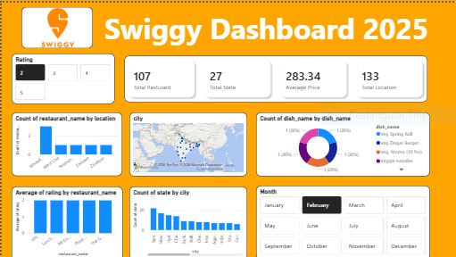

# Data Analytics Portfolio Projects

A comprehensive collection of end-to-end **Data Analytics** projects demonstrating data cleaning, exploratory data analysis (EDA), SQL querying, Python visualization, and interactive Power BI dashboarding.

---

## 📊 1. Swiggy Food Delivery Data Analysis (`Swiggy file project/`)

An end-to-end exploratory and visual analysis of Swiggy restaurant ratings, order volumes, pricing trends, and delivery performance using **Power BI, SQL, Python, and Excel**.

### Dashboard Preview

### Project Files & Direct Links
* **📄 Full Analysis Report (PDF):** [View Swiggy Report (`reportswiwggey.pdf`)](https://github.com/Manshu2003/Data_analytics_project/blob/main/Swiggy%20file%20project/reportswiwggey.pdf)
* **🖼️ Dashboard & Charts:** [Dashboard Image (`Dashboard.PNG`)](https://github.com/Manshu2003/Data_analytics_project/blob/main/Swiggy%20file%20project/Dashboard.PNG) | [Chart Visual (`download.png`)](https://github.com/Manshu2003/Data_analytics_project/blob/main/Swiggy%20file%20project/download.png)
* **🐍 Python EDA Notebook:** [View Jupyter Notebook (`Untitled.ipynb`)](https://github.com/Manshu2003/Data_analytics_project/blob/main/Swiggy%20file%20project/Untitled.ipynb)
* **🗄️ SQL Queries:** [Swiggy SQL Queries (`swiggeyy.sql`)](https://github.com/Manshu2003/Data_analytics_project/blob/main/Swiggy%20file%20project/swiggeyy.sql) | [Additional SQL (`sql.sql`)](https://github.com/Manshu2003/Data_analytics_project/blob/main/Swiggy%20file%20project/sql.sql)
* **📊 Power BI Template & Datasets:** [Power BI Template (`ww.pbit`)](https://github.com/Manshu2003/Data_analytics_project/blob/main/Swiggy%20file%20project/ww.pbit) | [Excel Data (`swiggy_data.xlsx`)](https://github.com/Manshu2003/Data_analytics_project/blob/main/Swiggy%20file%20project/swiggy_data.xlsx) | [CSV Data (`swiggy_data.csv`)](https://github.com/Manshu2003/Data_analytics_project/blob/main/Swiggy%20file%20project/swiggy_data.csv)

---

## 🏨 2. Hotel Booking & Revenue Analysis (`Hotel file project/`)

An in-depth analysis of hotel booking patterns, cancellation rates, customer demographics, and revenue performance built with **Power BI, SQL, Python, and Excel**.

### Dashboard Preview
)

### Project Files & Direct Links
* **📈 Visual Analysis Report (PDF):** [View Report with Graphs (`Hotel_Data_Analysis_Report_WITH_GRAPHS.pdf`)](https://github.com/Manshu2003/Data_analytics_project/blob/main/Hotel%20file%20project/Hotel_Data_Analysis_Report_WITH_GRAPHS.pdf)
* **📊 Power BI Dashboard Exports (PDF):** [View Dashboard PDF (`hotel.pdf`)](https://github.com/Manshu2003/Data_analytics_project/blob/main/Hotel%20file%20project/hotel.pdf) | [Summary Report (`hotel_report.pdf`)](https://github.com/Manshu2003/Data_analytics_project/blob/main/Hotel%20file%20project/hotel_report.pdf)
* **🐍 Python EDA Notebook:** [View Jupyter Notebook (`rr.ipynb.ipynb`)](https://github.com/Manshu2003/Data_analytics_project/blob/main/Hotel%20file%20project/rr.ipynb.ipynb) | [Notebook PDF (`rr.ipynb.pdf`)](https://github.com/Manshu2003/Data_analytics_project/blob/main/Hotel%20file%20project/rr.ipynb.pdf)
* **🗄️ SQL Queries:** [View Hotel SQL (`hotel.sql`)](https://github.com/Manshu2003/Data_analytics_project/blob/main/Hotel%20file%20project/hotel.sql)
* **📁 Power BI & Dataset:** [Power BI File (`hotel.pbix`)](https://github.com/Manshu2003/Data_analytics_project/blob/main/Hotel%20file%20project/hotel.pbix) | [CSV Dataset (`ee.csv`)](https://github.com/Manshu2003/Data_analytics_project/blob/main/Hotel%20file%20project/ee.csv)

---

## 🛠️ Tools & Technologies Used

* **Power BI** – Interactive dashboards, DAX measures, and visual storytelling
* **SQL** – Data extraction, filtering, aggregations, and business querying
* **Python (Pandas, Matplotlib, Seaborn)** – Data cleaning, EDA, and statistical plotting in Jupyter Notebook
* **Microsoft Excel / CSV** – Raw dataset structuring and preprocessing

---

## 👨‍💻 Author

**Manshu Jaiswal**  
* GitHub: [@Manshu2003](https://github.com/Manshu2003)
